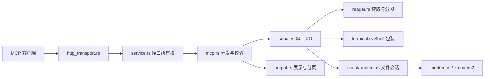

# 实现与协议

本文面向维护服务实现的开发者。对外参数和结果见 [工具手册](tools.md)，构建与修改流程见 [开发指南](development.md)，验证方法见 [测试与验收](testing.md)。

## 模块与请求路径



| 模块 | 职责 |
| --- | --- |
| `src/main.rs` | CLI、监听地址、服务启动和退出信号 |
| `src/http_transport.rs` | HTTP 请求头、Origin 检查、JSON 和 blocking worker |
| `src/service.rs` | 短锁注册表、端口所有权、生命周期互斥、busy 和取消路由 |
| `src/mcp.rs`、`src/mcp/schema.rs` | JSON-RPC、工具分发、参数校验和工具 Schema |
| `src/serial.rs` | 设备身份、设置、串口句柄和连接状态 |
| `src/reader.rs` | 总期限、静默窗口、分帧、尾部保留和取消轮询 |
| `src/terminal.rs` | 控制键、ANSI 清理、POSIX 命令包装和退出码解析 |
| `src/output.rs` | compact/detailed 响应、UTF-8 截断和有限分页缓存 |
| `src/serial/transfer.rs` | 文件启动命令、协议与 Shell 同步、共享未读队列和落盘 |
| `src/modem.rs` | X/YMODEM 的 CRC、序号、重传、取消与批结束 |

## HTTP 与共享状态

默认监听 `127.0.0.1:8765`，MCP 路径为 `/mcp`。POST 请求使用 JSON-RPC，请求头应包含：

```text
Content-Type: application/json
Accept: application/json, text/event-stream
```

服务返回 JSON 响应；通知不产生 JSON-RPC 结果。存在 `Origin` 请求头时拒绝请求，协议版本头若存在则必须为支持的版本。这些检查不提供身份验证或客户端隔离；同一进程的客户端共享串口、活动端口和输出缓存。

HTTP 请求进入 blocking worker。注册表只在解析端口、检查 busy、移出和归还状态时加锁，阻塞 I/O 在独占端口的局部 SerialHub 上运行。RAII lease 在正常返回和 panic 展开时归还状态。

MCP `notifications/cancelled` 只有在进程中 requestId 唯一匹配时才取消请求；多客户端场景可通过 `serial_cancel` 显式指定端口，避免 requestId 重复造成歧义。

同端口冲突立即拒绝，避免超时后排队的写入稍后突然执行。不同端口可独立工作。活动端口在请求开始时解析一次，后续选择变化不影响已开始的请求。连接生命周期互斥避免重连迁移覆盖其他连接。

状态查询先在锁外枚举设备，再更新空闲端口；忙端口返回操作前快照和当前操作信息。

## 读取、取消与未读队列

驱动单次读取最多 1024 字节。总期限和可选静默窗口在收取阶段计算，短驱动超时不能提前结束整体读取。读取最多每 50 毫秒检查取消标志；取消与完成可能竞态，以原请求结果为准。

分隔符可跨读取块。匹配后的尾部按原顺序放回连接的未读队列，与手动文件协议共享；仅显式清输入或连接重置才清除。精确长度读取同样保留后续字节。

取消等待不发送终端控制字符。文件传输和驱动写入不使用读取取消标志。没有后台采集线程，空闲时依赖驱动缓冲，持续日志应由客户端周期读取。

## POSIX Shell 包装

内部用八进制转义生成非可见、每次独有的开始、退出码和结束标记。命令源文本的回显不包含实际标记字节；只有标记与有效退出码完整匹配后，exec 才报告 completed。

请求在子 Shell 中执行，不持久化目录或环境变化。内部求值使用 `command eval`，标记使用 `command printf`，绕过同名函数或别名。超过 128 字节的命令分成短输入行，通过 here-document 送入辅助 Shell，在私有变量中重组；辅助 Shell 使用 `command -p sh` 查找，不修改用户命令看到的 PATH。

长输入按行和波特率控制发送节奏，同时收取终端回显及早期输出，减少嵌入式行编辑器限制和 UART 缓冲溢出。收取的字节保留给本次结果，接收上限包含回显。

exec 的默认 stdin 为 `/dev/null`。文件启动命令保留原始串口 stdin，长脚本通过文件描述符 3 传递，不能继承 here-document 的脚本输入。命令自身的管道和显式重定向保持有效。

## 文件协议与 Shell 同步

文件启动、协议会话和 Shell 同步在同一次端口独占操作内完成。自动命令在进入协议前等待开始标记，在结束后等待对应退出标记。ZMODEM 进一步等待对端真实头，避免终端回显被误当作握手。

Y/ZMODEM 使用文件元数据。ZMODEM 上传发送文件名的 basename，接收目录由远端接收程序决定，不能将元数据中的文件名视为远端目录切换。自动命令保护以减号开头的相对路径，避免被工具当作选项。

文件最多缓冲 64 MiB。Y/ZMODEM 校验声明及实际长度；XMODEM 没有原始长度，保留末块 `0x1A` 填充。接收完成后用 `create_new` 落盘，避免预检之后出现的同名文件被覆盖；保存失败清理本次新建的部分文件。

X/YMODEM 只按 NAK 或超时重传当前数据包；发送包后忽略延迟 CRC 请求等无关应答，累计达到 4096 个后取消，连续 CAN 表示对端取消。协议不得重放整个文件。ZMODEM 每 KiB 请求一次确认，限制对端退出后仍在发送的数据量。

只支持单文件。Y/ZMODEM 收到第二个文件时拒绝整个接收，不保存第一个文件；ZMODEM 拒绝时实际发送线上的 CAN 序列，不能仅改变本地状态。协议解析器需要更多输入时继续读取，兼容分片及 lrzsz 的 `0x8A` 换行和分批 `OO` 尾部。

Shell 同步失败时，若取得对应非零退出标记，错误保留协议原因、远端退出码与诊断。诊断只保留最近 16 KiB，错误文本最多展示 1024 个字符。协议取消或远端命令失败不等同于硬件断连；真实驱动错误仍更新连接状态。

## 展示与输出缓存

展示量与接收量独立。compact 正常结果去除 raw_data/hex 和空字段，只输出一份 JSON 文本；detailed 额外返回结构化对象以及适用的原始文本和 hex。

UTF-8 字段按字节截断并退到字符边界。仅为被展示截断的结果保留原始表示，缓存最多 16 项、合计 16 MiB，按 FIFO 淘汰，重启清空。单项不能保留时通过 output_note 告知。

分页不再访问串口。有效页长受 `limit` 和 `output_limit` 中较小者限制；`next_offset` 只推进实际展示的字节，`output_id` 保持不变，不因二次展示截断跳过数据。
